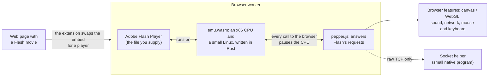
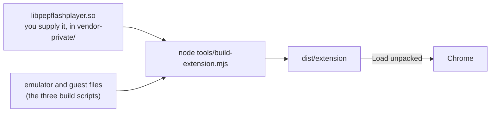

# flash-runner

Play Flash (`.swf`) in Chrome without a Flash plugin. flash-runner runs Adobe's own Flash Player inside a browser tab by emulating a 32-bit
Linux PC in WebAssembly. You supply the Flash Player file; this repository does not contain it.

> Experimental, and not affiliated with Adobe or HARMAN. Flash is end-of-life and the versions this runs have known security bugs, so do not
> open content you do not trust. See [THIRD_PARTY_NOTICES.md](THIRD_PARTY_NOTICES.md) for licensing.

How it fits together:



The plugin believes it runs on a Linux PC. Whenever it asks its "browser" for something (draw this, play that, fetch a URL), the emulator
stops and `pepper.js` does it with the real browser APIs. Details: [docs/ARCHITECTURE.md](docs/ARCHITECTURE.md).

## What you need

- **A Flash Player plugin you are allowed to use:** `libpepflashplayer.so`, 32-bit Linux PPAPI. Put it in `vendor-private/` (git-ignored; see
  [vendor-private/README.md](vendor-private/README.md) for the file names). Tested with 32.0.0.363 (the last build before Adobe's end-of-life
  block, preferred) and 26.0.0.151. Builds from 32.0.0.465 on show Adobe's "blocked" screen and do not run; this project does not try to bypass that.
- **Chrome, Chromium or Edge.** WebGPU is used when available, with a 2D fallback.
- **To build:** Rust (with the `wasm32-unknown-unknown` target), Node 24, Go, Python 3, `wasm-opt`, and podman for the 32-bit guest userland.
  On Windows read the notes in [CONTRIBUTING.md](CONTRIBUTING.md).

## Build and install the extension

```sh
tools/build-wasm.sh          # the emulator            -> web/emu.wasm
rootfs/build.sh              # the guest's Linux files -> rootfs/out/rootfs.tar
tools/build-guest.sh         # the glue program that loads the plugin
(cd ui && npm ci)            # settings and popup UI
node tools/build-extension.mjs   # -> dist/extension
```

`build-extension.mjs` also bundles the socket-helper installers from `native/out`. If you have not built them (`tools/build-helper.sh`, needs Go
and podman), run it as `NO_HELPER=1 node tools/build-extension.mjs`.



Then in Chrome: `chrome://extensions` -> turn on *Developer mode* -> **Load unpacked** -> pick `dist/extension`. Any page with a Flash
`<embed>` or `<object>` now plays, `.swf` links open in a viewer, and the toolbar popup can open a local `.swf`.

Chrome only accepts an off-store extension from a file on Linux. On Windows and macOS you do *Load unpacked* once; how each platform is packaged
(and why) is in [docs/DISTRIBUTION.md](docs/DISTRIBUTION.md).

## What works

Checked in Chrome with 32.0.0.363 (`tools/ext-test.mjs`, `tests/ext/`):

- Vector and bitmap drawing, text (device fonts and input fields), mouse and keyboard, fullscreen, clipboard paste, Flash's right-click menu.
- Video (FLV, and H.264/AAC MP4 through `NetStream`), audio, Shared Objects (kept in IndexedDB), HTTP(S) requests, `crossdomain.xml`.
- Stage3D through WebGL2 (the `gpu3d` setting, on by default).
- `ExternalInterface` in both directions (page to Flash is asynchronous, because the movie runs in a worker).

## What does not

- **Speed.** Heavy games run well below native Flash. A JIT turns hot x86 code into wasm ([docs/JIT.md](docs/JIT.md) has the measurements); there is
  no measurement of a real game, so expect nothing in particular.
- **Raw sockets** (`Socket`, `XMLSocket`) need the small native [socket helper](docs/HELPER.md), because a browser cannot open raw TCP. The
  settings page offers its installer.
- Not available: RTMP/RTMFP streaming, UDP, camera and microphone, file dialogs, gamepads, printing, and pages whose CSP forbids `eval`.
- Some games refuse to start without their publisher's own desktop launcher; nothing in a browser can stand in for that.

## For developers

```sh
cargo test -p emu --lib          # emulator unit tests, no Flash needed (about a minute)
node web/ppb-unit-test.mjs       # and the other web/*-test.mjs, tools/*-test.mjs listed in AGENTS.md
node tools/ext-test.mjs --bundled --seconds 10    # real Chrome with the extension (needs the runtime and a built dist)
```

| path | what |
|------|------|
| `crates/emu` | the emulator: x86 interpreter, x87/SSE/MMX, wasm JIT, ELF loader, Linux syscalls, threads, file system |
| `web/` | loader, worker, the Pepper host (`pepper.js`, `ppb-*.js`), presenters, dev server |
| `extension/`, `ui/` | the Chrome extension and its settings UI |
| `native/helper` | the Go socket helper |
| `guest/`, `rootfs/` | code that runs inside the emulator, and the Debian i386 files it needs |
| `tests/`, `tools/` | test programs, movies, pages; build and test scripts |
| `third_party/ppapi` | Chromium's PPAPI headers (BSD-3-Clause) |

More: [architecture](docs/ARCHITECTURE.md) · [JIT](docs/JIT.md) · [accelerators (LIR, AOT)](docs/ACCELERATORS.md) · [status and open issues](docs/STATUS.md) ·
[debugging and profiling](docs/DEBUGGING.md) · [socket helper](docs/HELPER.md) · [distribution](docs/DISTRIBUTION.md) ·
[what was learned about the plugin](docs/REA-FINDINGS.md)

Contributing: [CONTRIBUTING.md](CONTRIBUTING.md), and [AGENTS.md](AGENTS.md) for AI coding assistants. Security reports go through
[SECURITY.md](SECURITY.md). Participation is covered by the [Code of Conduct](CODE_OF_CONDUCT.md).

## License

[MIT](LICENSE-MIT) or [Apache-2.0](LICENSE-APACHE), at your option. Third-party parts keep their licences ([THIRD_PARTY_NOTICES.md](THIRD_PARTY_NOTICES.md)).
Adobe Flash Player, which you supply, is not part of this project and is not covered by it.
