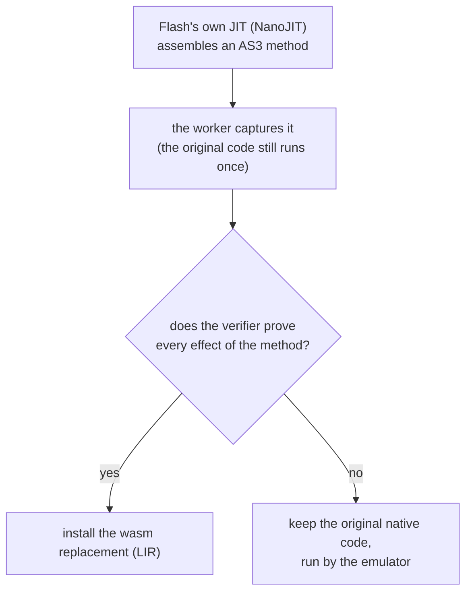
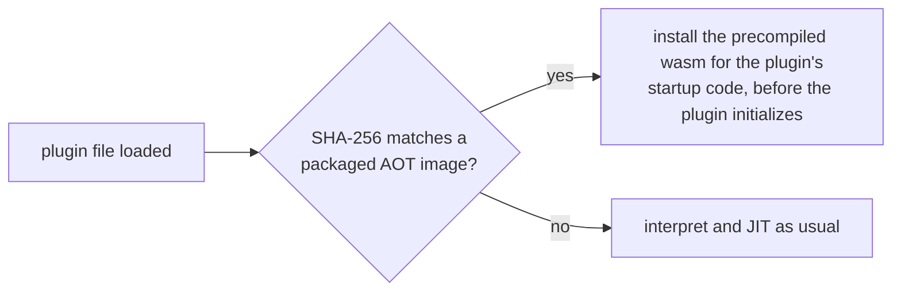

# Runtime HLE, normalized LIR and offline compilation

## Deployment status

| Component | Implemented and connected | Not established |
|---|---|---|
| New range-comparator HLE | Exact 36-byte signature, normal JIT detection, full-span SMC/protection dependencies; enabled with existing intrinsics switch | Combat speedup; standalone timings are mixed |
| LIR → wasm | Real Flash .363 hooks, validated integer and nested conditional slices, bounded receiver effects, exact-profile loops, and audited Number identity/negation/add/sub/mul/div with native x87 returns | General loops, arbitrary heap/runtime calls, exceptions, OSR and broader floating/SIMD operations remain native |
| Static x86 → wasm | Portable v2 symbolic relocations, metadata-seeded ELF function graphs, exact-image selection and automatic installation before plugin initialization | Complete-plugin coverage and arbitrary ELF relocation/linking |

Two of the layers, as flows. Both end in "run the original code" whenever something is not proven or does not match:





These are distinct layers. The worker now observes the verified compiler path in 32.0.0.363 and
replaces **only audited integer methods and bounded receiver-field effects**. This is real but partial replacement,
not a complete NanoJIT implementation. Unsupported methods keep their original native code and
run through the emulator. The original assembler still runs once before the replacement decision.
No new combat FPS claim is made. See [NANOJIT-ABI.md](NANOJIT-ABI.md) for binary evidence.

The worker enables available accelerators by default; embedders may pass `lir:false` / `aot:false`
to disable them independently. Unknown runtime hashes do not enable raw LIR hooks.

## Real Flash integration test

```sh
sh tools/build-guest.sh
sh tools/build-wasm.sh
node tools/build-plugin-aot.mjs
haxe -cp tests/swf-src -main LirLeaf -swf tests/swf/lir-leaf.swf -swf-version 11.2
haxe -cp tests/swf-src -main LirArithmetic -swf tests/swf/lir-arithmetic.swf -swf-version 11.2
node tools/flash-accelerators-test.mjs
```

The same AS3 fixture runs on the real plugin with native execution, LIR replacement, and
LIR+AOT together. It checks 200,000 calls plus signed overflow cases and paints a green pixel
only on the expected checksum. The test asserts the rendered result and nonzero live dispatch
counters, not just that modules compile. A commit-path counter inside the wasm wrapper recorded
**200,002 completed calls** (the loop plus two overflow tests), excluding guard retries. A combined run installed 105 static startup regions,
recorded 75,633 Rust AOT dispatcher entries, and executed a captured LIR leaf directly in wasm.
Counters exclude incoming wasm tail-call transfers and are not total-call or speed measurements.
That qualification applies to the Rust dispatcher counters; `completed_native_leaf_calls` counts
successful wasm completions even through tail calls.

The newer verifier symbolically executes the bounded native no-overflow paths, including spills,
callee saves, MethodFrame link/restore, stack-limit guard, integer ops and up to four nested
forward conditional diamonds. Each branch arm is proven from its own machine state. It requires the normalized result expression to match, rejects unknown reads/writes/calls,
and registers **all** native bytes through every return for SMC invalidation. The wrapper checks
guest bounds/protections, stack/argv/core aliases and argc before any state change. A successful
return preserves cdecl callee-saved state; caller-volatile fields and nonescaping dead stack are
permitted ABI differences. A refusal executes the original native method.

`LirArithmetic.swf` exercises add/sub/multiply, and/or/xor, all integer shifts, neg/not, a composed
expression, conditional comparisons, integer selection, and nested min/abs/clamp/sign
diamonds: **20 real Flash methods**. The earlier
15-method fixture recorded 280,013 completed wasm calls including warmup; adding typed hot calls
and selection now completes about 500,000 calls in wasm (small-budget calls correctly fall back).
Larger earlier runs completed
2,800,013 calls. Unsupported
methods remain on the native path. `tools/bench-flash-lir.mjs` runs alternating same-workload A/B;
current measurements have **not established a speedup** (one 200k-loop sample set: native median
1,769 ms, LIR 1,848 ms). Correct replacement is not sufficient evidence of performance improvement.

Offline metadata discovery now selects symbols, validated unwind/FDE entries, initializer and
declared R_386_RELATIVE code pointers inside executable sections. For .363 it emits **59,044 blocks,
306,275 instructions, 927,772 guarded bytes (~7.42% of executable section bytes)** in 58 modules.
The build is resource-bounded and reports 22,365 queued frontiers; this is not full-image AOT.
The first block-only install caused 5.24 million Rust dispatcher entries on the small fixture;
symbolic relocation of the live chaining cache reduced that to ~138k. Hot direct-dispatched
offline blocks may then tier to ordinary fused JIT regions. That optimization is explicitly JIT,
not hidden runtime static translation. Startup binding still costs ~174 ms and the wider AOT
workload has not yet demonstrated a net speedup.

The current plugin build now fuses those blocks offline into **1,064 bounded regions / 2 modules**
(.363), with v3 chain metadata. It preserves the same 927,772 translated bytes while guarding
5,509,527 envelope bytes separately (gaps are guarded, **not translated**). Wasm falls from
39.4 MB to 21.3 MB. A real Flash run installed 1,062 regions (two conflicting loader/probe
regions skipped), bound in ~100 ms, and recorded ~8,139 Rust AOT dispatch entries on the
arithmetic fixture. Result checksum still passed; net speedup remains workload-dependent.

With larger **discovery** limits (after fusion), .363's metadata-seeded queue can be exhausted:
2,605,002 decoded instructions, 483,193 supported blocks fused into 5,130 regions, and
8,901,487 translated bytes (~71.2% executable bytes), with zero budget frontiers. This still
leaves 88,153 decoded unsupported instructions/native-only targets—not “full plugin native wasm”.
Its ~246 MiB bundles and ~527 ms binding cost make it a coverage experiment, not the default
packaged artifact. A smaller 262,144-block experiment covered ~31.8% but was already ~126.6 MiB.
Runtime tests of both returned correct AS3 loop results; neither establishes a net speedup.
Discovery knobs are explicit: `AOT_MAX_BLOCKS` (up to 1,048,576) and
`AOT_MAX_INSTRUCTIONS` (up to 5,000,000) for the build script. The default remains resource-bounded.

### Serialized fallback records (v4, experimental)

`emu-aot --plugin-complete` additionally emits generic-interpreter calls offline for decoded
instructions outside portable direct lowering. Every call has an explicit kind-5 tag relocation
and an exact `(ELF IP, instruction bytes)` record. Binding decodes only those serialized records,
rebases their IPs, reserves local interpreter tags and links their annotated sites. It does **not**
discover or lower x86 code at runtime. All records must agree with guarded code; corrupt records,
missing/duplicate tag sites and incompatible layouts reject before publishing heads.

Tags are reserved transactionally, then retained by a shared module lease until its last live
region is retired. SMC and tier promotion cannot recycle tags still referenced by another export;
failed/zero-region installs release reservations idempotently. Module-level sharing avoids copying
the complete fallback list once per region. The runtime report distinguishes actual
`[aot] serialized_fallback_calls` from ordinary JIT fallback calls and dispatcher entries.

The first full .363 experiment compiled all 2,605,055 **discovered** instructions, including
88,156 interpreter-call records; this is not all executable bytes or all indirect targets and
not complete native-Wasm lowering. A real Flash run returned correct AS3 loop results and
recorded 7,339 serialized fallback calls, but binding took ~1.15 s and the small workload regressed.
The default packaged build therefore remains the smaller directly lowered v3 tier.

The runtime now uses a private `DecodedArtifact` owner: it consumes freshly validated metadata
and links the existing Wasm allocation in place. No mutation API is exposed between decoding
and linking; public mutable `Artifact::bind*` still revalidates. Tests require identical linked
bundles, preserved allocation pointers and rejection of modified metadata. This removes the
second encode/decode pass without trusting unchecked public fields. Also, tiny hot callees may
inline based on their actual decoded size, not the size of an unrelated fused AOT group.

The HLE-preserving build has 2,605,012 discovered non-HLE instructions, 4,948 regions and
88,156 serialized helper records, with zero budget/invalid frontiers. Chrome installed 4,946
regions, executed 7,713 serialized helper calls, and returned correct results from both LIR loops.
One rerun with in-place binding measured 419 ms versus the earlier 653 ms Chrome bind and
2,236 MiB versus 2,389 MiB linear-memory high-water mark. These are diagnostic observations,
not a controlled speedup of a real game; this experimental build remains too costly to make the default.

`node tools/aot-fallback-test.mjs` validates the actual V8 API with an offline x87 program,
same-code-page stores, four executed serialized helper calls and no JIT tier-up. Native tests
also compare IEEE corner cases, faults, poll/scheduler behavior and record/ownership corruption.

For an explicit experimental build, use `AOT_COMPLETE=1 node tools/build-plugin-aot.mjs --out DIR`.
This selects the larger discovery limits unless overridden. “complete” names the discovered-graph
mode, **not** whole-plugin completeness or a speed claim.
`AOT_RUNTIME=libpepflashplayer-32.0.0.363.so` restricts a test build to that known image, and
`AOT_DIR=DIR EXT_DIR=OTHER_DIR node tools/build-extension.mjs` keeps experimental assets and
the unpacked extension separate from the default distribution.

Packaged bundles are gzip-compressed by default (`AOT_COMPRESS=0` disables compression). Decode
runs before the synchronous plugin boundary, enforcing exact declared size and per-runtime limits
(128 MiB normally; 384 MiB only for the explicit discovered-with-fallback build). Default .363
artifacts occupy ~8.47 MB stored instead of ~37.6 MB decoded. The rebuilt extension is ~66.3 MiB,
and Chrome confirmed both counted-loop replacements with the compressed packaged AOT tier.

Adversarial verifier regressions explicitly reject dead native argv reads absent from the
marshalled range, sub-32-bit comparison semantics, unaligned overlapping spill writes, unknown
heap effects and callee-save corruption. Insufficient leaf budget returns `S_RETRY` so even
one-instruction scheduling slices make native progress. Probe tests cover retry resumption,
overflowing addresses and observations inside PIC thunks. Capture reads check actual guest
mapping/read permissions rather than raw host-buffer bounds; observation work is bounded.
The worker now defaults to checked guest loads; `jitTrustLoads:true` explicitly requests the
unsafe diagnostic shortcut rather than enabling it when a setting is absent.

### Receiver-field reads and transactional writes

`web/nanojit-memory.js` extracts integer return expressions using raw receiver/argv loads and
constant-offset receiver fields. Post-store loads forward the staged value. `lir/pure.rs`
independently proves the complete native return expression **and heap write effect**, not a
fixed getter/setter byte template. Every native field read (including discarded reads) must be
declared and preflighted. The current bound is aligned word fields within 4 KiB of the receiver,
and zero or one write whose value equals the verified return; arbitrary calls, reference write
barriers, indexed memory, multi-write transactions and GC safepoints are not accepted.

`lir/memory_region.rs` checks stack/core/argv permissions, actual argc, field bounds and object
aliasing before any mutation. The field interval must not overlap the transient native frame,
core fields or argv. Writable code pages reject through wtab and execute the original native
method, retaining ordinary SMC bookkeeping. Callee-save/FP/lazy state is preserved; a successful
transaction writes the field, return state, budget and completion counter, then may tail-chain.

`LirMemory.swf` now exercises six methods: getter, two-field sum, field+argument, setter, bump,
and a composed shift/XOR/arithmetic update. Real Flash has completed about 120,000 wasm calls
while checking returned values **and object state**. Native differential tests cover overflow,
faults, aliases, argc mismatch and writes on active code pages. An earlier five-method A/B was
slower (native median 142 ms, LIR 154 ms), so functionality is not advertised as a speedup.

```sh
haxe -cp tests/swf-src -main LirMemory -swf tests/swf/lir-memory.swf -swf-version 11.2
node tools/bench-flash-lir.mjs --workload memory --repeats 10 --runs 3
```

### Bounded real captured loops

`lir/counted.rs` verifies complete raw 63/73-record streams for two actual Flash .363 loop
profiles (sum and xorshift), including stores, unused reads, poll side exit and liveness records.
It also matches the complete native no-poll path, including checked random stack-address
blinding, rather than assuming a record count establishes semantics. The emitted recurrence
comes from those LIR frame loads/stores/arithmetic. It is **not** a general loop compiler.

Only `0 <= n <= 4096`, readable/writable disjoint frame/core storage, readable complete argv,
zero interrupt poll (`core+40`) and enough full-call instruction budget may use wasm. Otherwise
the entire native method runs unchanged. No calls/safepoints are skipped when a poll is active.
Tests cover dead memory effects, exact budget, poll refusal, malformed native/raw metadata,
one-instruction slices, SMC, FP/callee-save preservation and source results.

```sh
haxe -cp tests/swf-src -main LirLoops -swf tests/swf/lir-loops.swf -swf-version 11.2
node tools/bench-flash-lir.mjs --workload loops --repeats 30 --runs 3
```

One alternating real-runtime run measured native 98/105/91 ms versus LIR 78/94/77 ms
(medians **98 → 78 ms**, ~20% less time). This is one bounded offline workload on this host,
not evidence about combat scenes or frame rate in a real game. Randomly differing spill/register shapes are rejected rather
than guessed, so a run can lower only one of the two profiles while returning correct results.
A later alternating run exposed this coverage variance (native median 90 ms, LIR 97 ms when
two runs only lowered one profile). We then added an exact verified ESP-identity padding variant
in the untaken stack-overflow path, with its branch skip and binding length checked together.
The original best case must not be presented as an unconditional speedup.
After that fix, the same alternating script lowered both profiles in all three LIR runs:
native **89/91/90 ms**, LIR **81/77/82 ms**, medians **90 → 81 ms (~10% less time)**,
with 33,072–33,100 successful wasm completions per run. This is the current reproducible
bounded-loop result, not a claim about arbitrary loops or a live game.

## New HLE

`INTR_RANGE_CMP` recognizes the runtime's standalone address-range comparator, previously only
recognized as the callback of the existing bsearch intrinsic. It checks every assumed byte and
execute permission. Guards preflight stack/argument accesses and aliases before modifying state;
unusual cases retry the original instruction stream. Registers, arithmetic flags and dead stack
bytes follow the original function, including its conditional second load.

The signature occurs once in an executable segment of each locally supplied plugin tested
(26.0.0.151, 32.0.0.363, default plugin). This was verified by byte scanning, not symbol recovery.
20,000 randomized differential cases and tail-byte/protection invalidation tests pass.
The standalone fixture did **not** demonstrate a consistent performance benefit.

## Normalized LIR

```sh
cargo run -p emu --bin emu-lir -- tests/lir/scalar.lir scalar.wasm
```

Or, with an initialized `Emulator` object:

```js
const trace = emu.compileLir(sourceText);
trace(3, 3.9); // [0, 3n]
trace(4, 3.9); // [7, 0n]: guard exit 7; host may restart from its retained inputs
```

`trace(arguments...) -> (status:i32, payload:i64)` uses status zero for a normal return.
Integer payloads are sign-extended; double payloads contain IEEE bits. Positive status is a
guard ID, not a native continuation pointer. Modules have no imports or memory effects.

Supported: i32/f64 constants/arguments, wrapping integer arithmetic, bitwise operations, masked
shifts, signed/unsigned comparisons, double arithmetic/comparisons, conversions, selects, guards,
and typed returns. `d2i` follows IA32 SSE truncate/integer-indefinite behavior without wasm traps.
Floating arithmetic uses wasm semantics, **not arbitrary MXCSR/x87 control modes**; arithmetic
NaN payloads are unspecified. Unsupported opcodes, type mismatches and undefined values reject.
Loads/stores, calls, labels, loops and live-state snapshots are not supported.

Opcode semantics reference:
`adobe/avmplus@858d034a3bd3a54d9b70909386435cf4aec81d21/nanojit/LIRopcode.tbl`.
`argd` and the text capture format are explicitly normalized conventions, not raw NanoJIT ABI.

## Offline compiler and runtime installation

```sh
cargo build -p emu --bin emu-aot
```

After boot/spawn, obtain instance-specific addresses with `emu.aotLayout()`:

```text
emu-aot INPUT.elf OUTPUT_PREFIX --entry ELF_VADDR \
  --guest-base GUEST_BASE --rtab RTAB --wtab WTAB \
  [--load-bias LIBRARY_BASE] [--allow START:END] [--profile RANGES_FILE]
```

Entries/ranges are **ELF virtual addresses**, not file offsets. The ELF load bias is different
from the wasm address of guest RAM. The optional profile file contains `START:END` ranges,
one per line, with `#` comments. Output: `.aot` bundle, `.wasm` module and `.json` manifest.
The caller must already have loaded/relocated the ELF into the guest. Exact byte guards reject
relocation changes not represented by the input; `aot::prepare` also supports explicit live-memory input.

Portable compilation adds `--portable` (audited integer/SSE move/logic subset), `--partial` (unsupported
instructions become dispatcher frontiers), or `--plugin-startup` (discover the actual exported
plugin startup graph). v2/v3 bundles explicitly mark guest-code addresses and guest/table wasm
operands, using fixed-width relocation slots. `Artifact::bind` patches only those slots; it never
decodes or retranslates x86 and never guesses relocations from coincident numerical constants.

```js
const count = emu.installAot(trustedBundleBytes); // Uint8Array, between scheduler calls
const portableCount = emu.installPortableAot(portableBytes, pluginLoadBias);
```

The Node runner also accepts `--jit N --aot trusted-file.aot`. Compilation happens offline;
runtime installation still pays V8 module compilation/instantiation. Native/browser layouts,
including every baked-in Cpu field offset, must match exactly. A bundle from a different boot
may be rejected. `tools/build-plugin-aot.mjs` generates portable function bundles offline for
locally supplied runtimes. Packaging includes these assets. The worker selects only the complete
matching SHA-256 image and binds at `HC_PLUGIN_LOADED`, after dlopen relocations but before
PPP_InitializeModule and plugin-created threads. Broader metadata-selected batches use
`--plugin-functions`, emitted as numbered modules plus `.index.json`; `--portable-index` loads
that index in the Node Flash harness. Already compiled loader thunks are retained;
colliding new block slots are discarded without replacing existing entries. Missing/invalid
bundles retain normal execution. There is no arbitrary third-party wasm download.

Strict compiler jobs emit a region per basic block; plugin jobs fuse nearby supported nodes
within 96-node/1,500-instruction/8,192-byte bounds and preserve actual external chain heads. Direct edges,
calls/returns and supported exits work; static targets outside the selected range use the ordinary
dispatcher. Portable integer indirect calls/jumps are dynamic dispatcher exits, not statically
resolved edges. Conflicting instruction streams, invalid decoding and runtime-local fallback
tags reject in strict mode; partial mode records unsupported frontiers and may resume discovery at
their decoded fallthrough without compiling them. Intrinsics/wasm-SIMD/profiling are disabled;
the function-bundle mode has an explicit symbolic live-cache relocation for tail chaining, requiring
host tail-call support. Limits include 1,024 installed regions per module, 64 MiB wasm
and 16 MiB byte guards per bundle. Split larger jobs explicitly.

Installation validates the layout, all byte guards, execute permissions, metadata and duplicate
heads before publishing entries. Installed regions use normal park/restore and exact-range SMC
invalidation. On rejection, the ordinary interpreter/JIT remains available.

**Bundles are trusted executable input sharing emulator memory.** Guards and FNV identifiers are
compatibility/reproducibility checks, not authentication or a sandbox for downloaded wasm.

## Verification

```sh
cargo test -p emu
sh tools/build-wasm.sh
node tools/accelerators-test.mjs
RUNNER=wasm JIT=2 sh tools/difftest.sh '*'
cargo test -p emu intrinsic_range_cmp_shipped_plugin_signatures -- --ignored --nocapture
```

The V8 API test compiles/runs LIR through the deployed wasm export and installs an offline-compiled
ELF loop into the real emulator dispatcher. It checks the program result plus stale code, wrong
layout, truncated bundles and duplicate installation. Native tests also check AOT park/unpark and SMC.
These tests establish the supported contracts, not full Flash integration or gameplay performance.

An offline smoke compile of the supplied 32.0.0.363 plugin's verified comparator at ELF virtual
address `0xa4de54`, limited to its 36-byte span, produced three basic-block regions and 1,934 wasm
bytes. This establishes that the compiler also accepts that shipped-runtime function, not just
the synthetic ELF fixture. Its test layout addresses were illustrative; that artifact was not
installed into a live Flash session.
