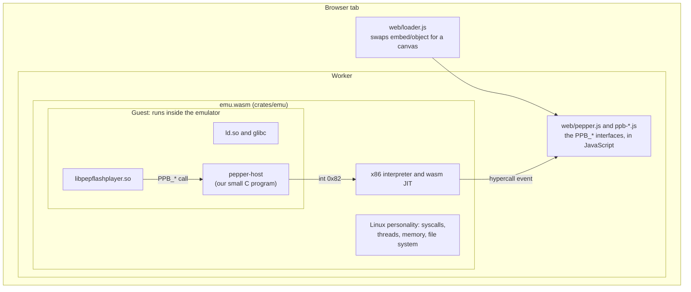
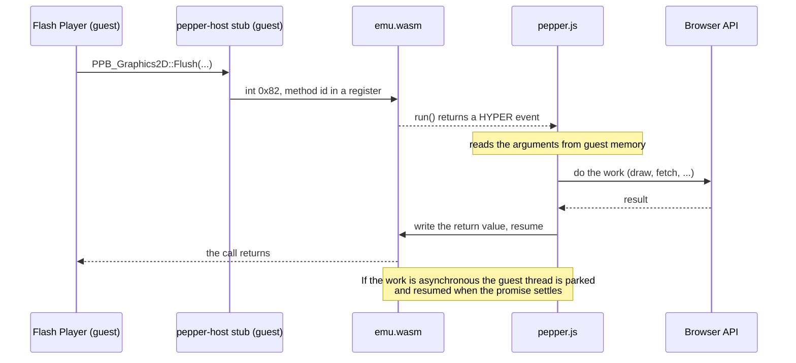
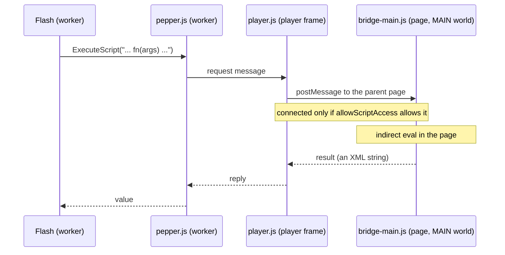

# flash-runner architecture (working notes)

Goal: run the unmodified Adobe/Harman Flash runtime (PPAPI, ia32 Linux) inside a browser tab with
WebAssembly + WebGPU, without the Flash plugin.

Everything below is derived from REA analysis of `libpepflashplayer.so` 32.0.0.465 (see
docs/REA-FINDINGS.md).

## Layers

Read it from the outside in: the page gets a canvas from `loader.js`; the worker holds the emulator and the JavaScript side of the plugin's
interfaces; inside the emulator the Flash plugin runs like a normal Linux program.

1. `crates/emu` — x86-32 user-mode emulator + Linux personality (Rust -> wasm32)
   - `cpu.rs`/`int.rs`/`fpu.rs`/`sse.rs`: IA-32 interpreter on iced-x86 decoder (block cache)
   - `jit*.rs`/`wasm_emit.rs`/`run.rs`: tiered wasm JIT for hot blocks (design and measurements: docs/JIT.md)
   - `mem.rs`: flat guest memory, per-page R/W/X, self-modifying-code tracking (AVM2 JIT)
   - `elf.rs`/`kernel.rs`/`sys.rs`/`signal.rs`/`vfs.rs`: ELF loader, ld.so, syscalls, futex, clone,
     signals, in-memory VFS (tar), cooperative green-thread scheduler
2. `guest/pepper-host` — tiny i386 C program (our code) that dlopen()s the plugin and exports the PPB_*
   tables; each PPB call becomes `int 0x82` to the embedder.
3. `web/` — JS embedder: Pepper (PPB_*) semantics on browser APIs, WebGPU presenter, loader that swaps
   `<embed>`/`<object>` for a canvas.

## One call from the plugin to the browser

Every `PPB_*` function the plugin calls ends in a stub of `pepper-host` that executes `int 0x82`. The emulator stops, `run()` returns a
HYPER event, and `pepper.js` runs the matching JavaScript:

## Milestone ladder
- M1 interpreter runs static+dynamic glibc programs  <- done (the full user-mode i386 integer ISA, including the
  legacy corner: BCD adjusts, nested `enter`, `bound`, `jcxz`, far-pointer loads, `lar/lsl/verr/verw`,
  `sgdt/sidt/sldt/smsw/str`, `arpl`, `icebp`, `sysenter`; differential-tested in `tests/progs/legacy_*.c`)
- M2 x87 + SSE/SSE2 complete, differential tests vs i386 container
- M3 pthreads, futex, signals; wasm build + browser driver
- M4 pepper-host + PPB (Graphics2D/ImageData/Core/Instance/View/URLLoader/Var/Messaging/InputEvent)
- M5 audio, Graphics3D/GLES2 -> WebGL2 -> WebGPU
- M6 wasm JIT for blocks, perf  <- done (on by default in the worker; `emu.setJit(N)`, 0 = off)

## Scripting bridge (ExternalInterface, window object)
Observed by tracing a real 32.0.0.363 build (`web/flash-smoke.mjs --trace`) and by `strings` on the library, not by decompilation:
- **Flash -> page.** `ExternalInterface.call` becomes `PPB_Instance_Private::ExecuteScript` with a script of the form
  `try { __flash__toXML(fn(args)) ; } catch (e) { "<undefined/>"; }`; the first call also injects the `__flash__*` XML helper
  functions. Flash reads the script's value (an XML string) back. It learns the embedding page's URL through
  `GetWindowObject` -> `top.location.href` (it applies `allowScriptAccess` itself from that URL).
- **Page -> Flash.** Flash does *not* announce `addCallback` names to the page (no `__flash__addCallback` call; `HasMethod` is false for
  them). Its instance object (`PPP_Instance_Private::GetInstanceObject`, a `PPP_Class_Deprecated`) answers `CallFunction(xml)` and also
  `Call(name, args)` directly; the XML form returns a JS expression for the page to `eval`.
- **Our implementation.** `web/scripting.js` invokes `PPP_Class_Deprecated` (the guest runner has a struct-return path, `call_var`,
  because `PP_Var` is returned through a hidden pointer). `ppb-misc.js` turns `ExecuteScript` / window-object property access into
  request/reply messages (`opts.page`); in the extension they travel worker -> `player.js` -> parent page, where
  `extension/content/bridge-main.js` (MAIN world) evaluates them with indirect `eval` and keeps a handle table (1 = window, 2 = the hosting
  iframe). The same script gives the iframe element Flash's scriptable surface: any unknown identifier becomes an **async** forwarder, so
  `await el.myCallback(x)` works (page code cannot block on a worker, hence Promises). Without a page (Node tests, the standalone viewer)
  a small local stub window is used.
- **Script-access policy.** Flash applies `allowScriptAccess` itself, but the host does not rely on that: `extension/player/player.js` only
  connects the page bridge when the rule holds (`always` -> yes, `never` -> no, default `sameDomain` -> the movie's host equals the
  page's host). Otherwise the worker gets no bridge and answers `ExecuteScript` with an exception, so even a compromised runtime cannot run
  script in the embedding page. Without a bridge nothing is evaluated locally either (no `eval`/`Function` in the worker); the stub window
  is read-only data (own properties only). Verified in Chrome: same-domain allowed, `never` blocked, cross-domain blocked by default and
  allowed with `always` (`tests/ext/ei2.html`, `ei-never.html`, `ei-cross*.html`).
- Limits: on pages whose CSP forbids `eval` only the script shapes Flash really sends run (without `eval`, see STATUS.md); raw Flash sockets are not available inside the emulator (it has no
  network stack); the extension provides them through the native socket helper (see [HELPER.md](HELPER.md)).

The same path carries the page scripting calls. In the extension a script request travels worker, `player.js`, parent page:

## Raw sockets
Flash 32 opens sockets through `PPB_TCPSocket_Private;0.5` (plus `PPB_NetAddress` / `PPB_NetAddress_Private` for addresses; the public
`PPB_TCPSocket;1.x` is implemented too). `web/ppb-sockets.js` implements the interfaces on top of a backend object (`connect/write/close/tls`
+ an `onEvent` stream): `web/socket-node.mjs` for Node tests, `web/socket-bridge.js` in the browser. The bridge forwards requests worker ->
`extension/player/native-sockets.js` -> `chrome.runtime.connectNative('com.flashrunner.sockets')` -> `native/helper (Go)`
(JSON, base64 payloads, one helper process per player, length-prefixed as native messaging requires). Flash itself first asks for a socket policy
file (port 843, then the target port) through the same sockets, so its own security model stays in force; the helper additionally blocks
non-public addresses by default. Reads are buffered per socket (pause/resume towards the helper above 8 MiB), writes complete when the helper has
handed the bytes to the OS.

