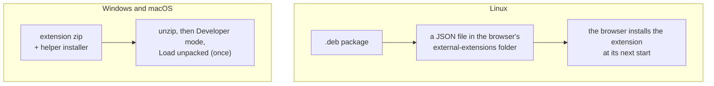
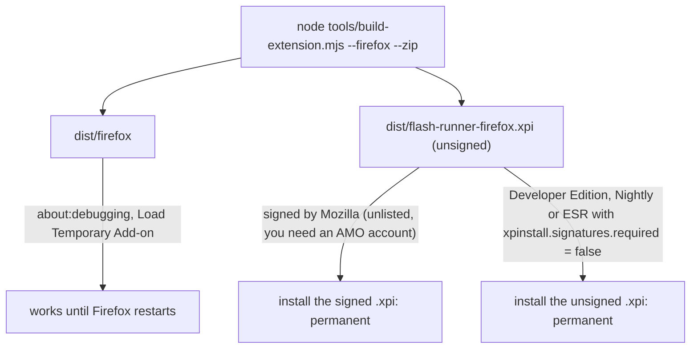

# Distribution

How the extension and the online game helper reach users, and why that differs by operating system. The README has the short version; this file
has the measurements and the research behind it.

## What is handed out

**Only the no-runtime build may be given to other people.** `node tools/build-extension.mjs --no-runtime [--firefox] [--zip]` leaves out Adobe Flash Player and the
AOT bundles (they are compiled from Flash's machine code, so they count as derived from it), writes an empty `assets/runtimes/runtimes.json` and a
`NOTICE.txt` that says so, and fails (exit 3) if any `.so`, `.aot` or foreign ELF file ended up in the output. Archives are named
`flash-runner-extension-no-flash.zip` and `flash-runner-firefox-no-flash.xpi`. Without a runtime the extension has nothing to run: the user installs one on the
settings page (checked: this build plus `--runtime vendor-private/...` in `tools/ext-test.mjs` runs the RTMFP test movie to its PASS square). The default build
bundles Adobe's binaries, which this project may not redistribute, and is for the builder's own machines. The Linux and macOS installers wrap the default
build today, so they are not shareable either until they are built from the no-runtime one.




**Windows and macOS** get the extension zip plus the helper installer: `dist/flash-runner-extension.zip` (from `node tools/build-extension.mjs --zip`),
and `native/out/FlashHelper-Setup.exe` / `FlashHelper.pkg` (from `tools/build-helper.sh`; the extension's settings page also offers the right one).
The user does Developer mode + Load unpacked once. A CRX does not help there (blocked, see below). **Linux** installs itself from
`dist/flash-runner_<version>_{amd64,arm64}.deb`. No Windows installer exists (an NSIS plan was dropped: the extension would still need
Load unpacked); the launcher below was measured but not built; the macOS `.pkg` is an optional alternative.

## Firefox

`node tools/build-extension.mjs --firefox [--zip]` writes `dist/firefox` (and an unsigned `dist/flash-runner-firefox.xpi` with `--zip`): the same extension with the manifest changes
in `tools/firefox/manifest-overlay.json` (an event page instead of a service worker, `options_ui`, the add-on id `flash-runner@khoaakt.github.io`, Firefox 140 or newer).



Why it is not a one-click install: release Firefox only keeps signed add-ons, and this one cannot be listed on addons.mozilla.org. It bundles Adobe's Flash Player (a binary Mozilla's
review does not accept and we may not redistribute), carries the socket-helper installers, and uses indirect `eval` for the page scripting bridge. Self-distribution needs Mozilla's
signing for unlisted add-ons (`web-ext sign`, your own API keys). `web-ext lint` reports no errors; its warnings are exactly those points.

The socket helper needs its own manifest for Firefox: Firefox names the add-ons that may start the helper in `allowed_extensions` and rejects a manifest that carries the Chromium
`allowed_origins` key, so each browser family gets a separate file (see [HELPER.md](HELPER.md)). The installers write both.

Checked with Firefox 157 on Windows only. Not checked: macOS and Linux Firefox, Firefox ESR, Stage3D, audio.

## Linux packages (`dist/flash-runner_*_{amd64,arm64}.deb`)

```sh
node tools/build-extension.mjs && node tools/build-installer-linux.mjs     # podman builds with dpkg-deb; needs native/out
node tools/installer-linux-test.mjs [--no-chromium]                        # ~1 minute; images: debian:bookworm-slim (amd64), arm64v8/debian, node:24-bookworm (both)
```
Contents: the signed CRX (`/opt/flash-runner/flash-runner.crx`, packed by `tools/installer/crx.mjs`, a dependency-free CRX3 packer with a reader
for tests), `<id>.json` (`external_crx` + `external_version`) in `/opt/google/chrome/extensions`, `/usr/share/google-chrome/extensions`,
`/usr/share/microsoft-edge/extensions` and `/usr/share/chromium/extensions`, the helper (`/usr/lib/flash-helper/flash-helper`, the same files as the
standalone deb) with system-wide native messaging manifests for Chrome, Chromium, Edge and Brave, README and copyright (the Adobe notice).
`Conflicts/Replaces/Provides: flash-helper`, so it replaces the standalone helper package cleanly. The version is the usual stamp
(`0.1.<days>.<minute>`), identical in the deb, the JSON and the CRX's manifest: Chrome compares `external_version` to update.

Measured in `installer-linux-test`: CRX signature verifies and its ID is the extension's; same 66 files as `dist/extension`; every file root-owned,
JSON/CRX world-readable; helper byte-identical to `native/out` and passes `native/helper-test.mjs` on amd64 (emulated) and arm64 (native);
`dpkg -i`/`-r`/`-P` leave nothing behind; installing it replaces the standalone `flash-helper` deb; in a Chromium container the extension
appears by itself, ENABLED, and is gone after `dpkg -r` and a restart. **Not tested: Chrome or Edge for Linux** (none on the arm64 VM used for testing);
the Chrome behaviour rests on Google's documentation ("Linux users won't be prompted to enable the extension; it is installed automatically").
Open: Brave/Vivaldi directories are undocumented (extension not added there); an RPM or a generic tarball is not built.

## macOS installer (`dist/FlashRunner.pkg`, optional since the decision above)

An alternative to the zip for macOS, for a project that does not publish to the Chrome Web Store: one installer that also installs the online game helper by default.

```sh
node tools/build-extension.mjs && node tools/build-installer.mjs     # needs native/out from tools/build-helper.sh; -> dist/FlashRunner.pkg
node tools/installer-test.mjs [--no-chrome]                          # no root needed; expands the package in a scratch directory
```

One product archive, two choices, both selected by default (`installer -showChoiceChangesXML` confirms it): the extension (an unpacked
folder in `/Applications/Flash Runner/extension`, plus `Uninstall.command` next to it) and the online game helper (`native/out/FlashHelper.pkg`
reused as it is: binary in `/Library/Application Support/FlashRunnerHelper`, system-wide `NativeMessagingHosts` manifests for Chrome,
Chromium, Edge, Brave and Vivaldi). Each installer stamps its own manifest version (`major.minor.<days since 2026-01-01>.<minute of day>`,
`tools/installer/layout.mjs`) because an unpacked extension has no auto-update; `dist/extension` keeps the source version. The last page
of the installer lists the one manual step.

**The installer cannot switch the extension on. Measured on Chrome 155, macOS:** a CRX signed with `vendor-private/extension-key.pem`
and registered through `<user-data-dir>/External Extensions/<id>.json` (`external_crx`) is installed with the right ID, then disabled
(`disable_reasons: [256]`); `chrome://extensions` shows "Not from Chrome Web Store ... may have been added without your knowledge" with a
locked toggle (`disabled: true`), and `chrome.management.setEnabled` fails with "cannot be modified by user". So the user still does
chrome://extensions -> Developer mode -> Load unpacked once. Do not spend more time on `ExtensionInstallForcelist`, configuration profiles or
`--load-extension` (removed from branded Chrome 137+): the machine used for these measurements was MDM-managed, and enterprise policy must not be written on machines you do not administer.

What `tools/installer-test.mjs` proves: the choices and pages; same 66 files and bytes as `dist/extension` apart from the stamped version;
the extension ID derived from the manifest key equals the one `native/helper/main.go` allows; the signing key is not in the package; the
packaged helper is byte-identical to `native/out/flash-helper-darwin` and passes `native/helper-test.mjs`; `postinstall` and `Uninstall.command`
on copies (`FLASH_EXTENSION_DIR`, `FLASH_UNINSTALL_ROOT`); and `ext-test --bundled --native --page tests/ext/sock.html` against the payload's
extension folder (a path with a space), including a socket echo through the helper. **The Installer itself was run on a real Mac** (build 0.1.290.301): "installation completed successfully", receipts
`com.flashrunner.helper` and `com.flashrunner.extension`, 66 files in `/Applications/Flash Runner/extension`, `flash-helper --version` -> 2, the
Chrome manifest registered, and **no `._*` file anywhere** under `/Applications` or `/Library/...`: the Installer folds the AppleDouble
entries back into attributes. Not verified: Chrome loading that installed folder through the real Load unpacked button.

The first version of the last page was long and was judged too hard for users (a wall of text, then Developer mode + Load unpacked by hand). It is now
three steps (292 characters, locked by `installer-test`) and the rest lives in `/Applications/Flash Runner/README.txt`. The manual step itself
cannot go away while the extension is loaded into the user's own Chrome; see "Launcher feasibility" below.

### Could configuration install the extension silently? (researched 2026-10-18)
Per Google's own pages (developer.chrome.com "Install extensions" / alternative installation, and the `ExtensionInstallForcelist` policy text):
- **Linux: yes, officially.** `/opt/google/chrome/extensions/<id>.json` (or `/usr/share/google-chrome/extensions/`) with `external_crx` +
  `external_version`; "Linux users won't be prompted to enable the extension; it is installed automatically." Delete the JSON to uninstall; a
  user who removes it in the UI gets it blocklisted. Edge on Linux: `/usr/share/microsoft-edge/extensions/`. Not tested in real Chrome here (no
  Chrome for Linux on the arm64 VM used); only Chromium in a container could exercise the mechanism.
- **Windows and macOS: no, on a normal PC.** `external_crx` is Linux-only (blocked on Windows since Chrome 33, on macOS since Chrome 44; it
  matches what was measured here). Force-installing an off-store extension by policy needs the instance joined to Active Directory or Azure
  AD (Windows), managed by MDM or joined via MCX (macOS), or enrolled in Chrome Enterprise Core (both). Ordinary players' machines are none of those.
- The only configuration route for ordinary Windows/macOS machines is Chrome Enterprise Core: the installer plants an enrollment token
  (HKLM policy key; `/Library/Google/Chrome/CloudManagementEnrollmentToken` or a profile on macOS) and the developer's Google admin console forces
  the extension from an HTTPS update URL. It makes the developer the admin of every user's Chrome (managed badge, any policy pushable, a browser
  inventory), needs an admin account and hosting. Not recommended. Never write enterprise policy on a machine you do not administer.
- Not done on purpose: editing Chrome's protected Preferences/Secure Preferences to inject an extension. That is the sideloading trick adware
  uses; Chrome treats it as tampering.
- `--load-extension` is gone from branded Chrome 137+, but Chromium and Chrome for Testing keep it (Chromium-extensions PSA, April 2025).

### Launcher feasibility (measured, macOS, branded Chrome 155, headed)
`Extensions.loadUnpacked` (what `ext-test` uses) loads this extension with no manual step. Run on a dedicated `--user-data-dir` with
`--remote-debugging-port=0 --enable-unsafe-extension-debugging`, from the installed folder:
- The window is clean: no "unsupported flag" bar, no automation banner; a normal site loads; the extension opens its settings tab.
- If the controlling process exits, Chrome and the extension keep running (port transport; with `--remote-debugging-pipe` Chrome would
  follow its parent, so use the port).
- The extension is **session-only**: after Chrome restarts it is gone, so a launcher must load it on every start.
- `chrome.storage.local` written in one session is there after the next launch on the same profile.
- Caveats: Chrome refuses remote debugging on the default profile, so the launcher has its own profile (players log in to the game again
  there); it relies on testing flags Google could restrict later; on Windows the helper still registers through HKCU.

Notes and open items:
- pkgbuild stores every `com.apple.provenance` attribute as a `._*` entry (81 of 163 entries) and prints "write: Permission denied". `xattr -d`
  silently keeps that attribute, and files created by a provenance-tracked process (some sandboxed shells are) get it anyway. The real
  install left no `._*`, so `postinstall` (which deletes any in the extension folder) is only a safety net. `FlashHelper.pkg` carries the same `._*` entries (harmless: Chrome opens
  `<name>.json` only); `xattr -cr` does not help there either.
- `ext-test` without `--bundled` or `--runtime ...363.so` uses `vendor-private/libpepflashplayer.so`, which is Flash **32.0.0.465** (post-EOL):
  it shows Adobe's "blocked" tile and never runs the movie, so every movie check fails or times out. Not a regression.
- A copy loaded unpacked from `dist/extension` has the same extension ID as the installed one. Measured (throwaway profile, CDP
  `Extensions.loadUnpacked`, one session): loading the payload folder over it leaves one card with the new path and version, ENABLED, and
  a probe in `chrome.storage.local` survives. Not measured: the real chrome://extensions button, a browser restart, IndexedDB (the Flash
  saves from `persist.js`). Removing an unpacked extension outright clears its storage; do not advise it.
- Windows has no installer of its own (see the distribution decision): zip + `FlashHelper-Setup.exe`. If one is ever wanted: `FlashHelper-Setup.exe` is the
  native host itself (`copySelf`), so do not embed the 68 MB extension in it; a separate per-user setup (NSIS from a container, helper installed by
  running `FlashHelper-Setup.exe install --quiet`, uninstall via the installed copy's `uninstall --quiet` then deleting its folder) would be the way,
  untestable from macOS, and Chrome would still need Load unpacked.
- Unsigned: a package built locally has no quarantine attribute and opens directly; a downloaded or AirDropped copy is quarantined and
  macOS then wants System Settings -> Privacy & Security -> Open Anyway (not tried here). Signing and notarizing needs a Developer ID.
