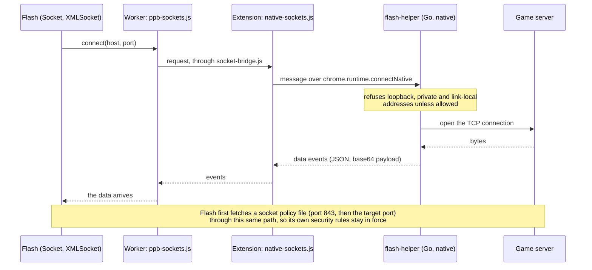

# Socket helper

`flash.net.Socket` and `XMLSocket` (including socket policy files) need a raw TCP connection, which a browser cannot open. A small program on
the user's machine opens it instead (`native/helper`, one Go binary). Chrome starts it through native messaging, and only this extension's
id may talk to it.

The path of one connection:

## Rules it enforces

It refuses loopback, private and link-local destinations unless `~/.flash-runner/sockets.json` contains `{"allowPrivate": true}`. The same file
accepts `allowHosts` / `denyHosts` globs and `maxSockets`. The `FLASHRUNNER_SOCKETS_CONFIG` environment variable points to another config file.

## Installing it

The extension's settings page offers the installer for the user's OS. Double-clicking `FlashHelper-Setup.exe` (Windows) installs it for the
current user without administrator rights; `FlashHelper.pkg` (macOS) and `flash-helper_amd64.deb` (Linux) do the same system-wide.
`tools/build-helper.sh` cross-compiles the helper and packages all three; they are unsigned, so Windows and macOS warn once.
Developers can register a checkout's build directly with `tools/install-native-host.sh`.

When a movie opens a socket and no helper is installed, the player shows a bar with an Install button over the movie, the toolbar button gets a
"!" and the popup offers the install (it opens the settings page at its Connection section). All of it goes away once the helper answers.

## Testing it

| command | what it checks |
|---|---|
| `node native/helper-test.mjs <helper binary>` | the protocol, against a local echo server: connect, write, pause/resume, errors, the address rules |
| `node tools/native-sockets-test.mjs` | the detection logic in the player (reported once, retried now and then, withdrawn when the helper appears), no browser |
| `node tools/ext-test.mjs --native --page tests/ext/sock.html --seconds 10` | `tests/swf/sock.swf` through the real helper in Chrome, against an echo and policy server |
| `node tools/ext-test.mjs --no-helper --page tests/ext/sock.html` | the "helper missing" notice in Chrome |
