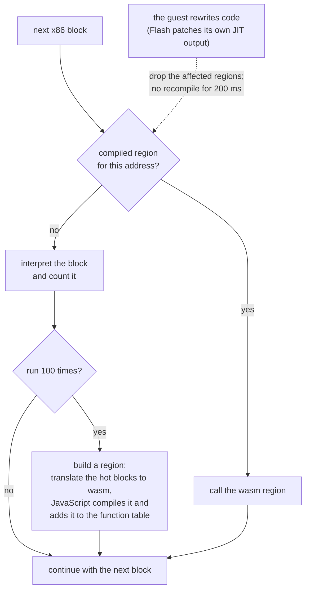

# IA-32 -> WebAssembly JIT

The interpreter (`Cpu::exec`) stays the tier-0 engine and the universal fallback. Blocks that get hot are
translated into WebAssembly functions that the browser (V8 / SpiderMonkey / JSC) compiles to machine code.
Everything below is the design as implemented; numbers are in the last sections.

```
crates/emu/src/
  jit_x86.rs    x86 -> wasm translator (target independent; only builds bytes)       ~2.4k lines
  jit_simd.rs   SSE/SSE2 integer + move instructions -> wasm SIMD (child module of jit_x86)
  jit_flags.rs  lazy EFLAGS: tuple kinds + `eval` (the single definition of what a tuple means)
  wasm_emit.rs  tiny wasm binary assembler (no dependencies)
  jit.rs        runtime: region registry, install/free glue, chaining table, helpers called by compiled code
  run.rs        BlockCache + Cpu::run: tiering, region selection, dispatcher
  jit_tests.rs  native differential tests: translator output executed by wasmi vs the interpreter
web/emu.js      host side: compiles modules, parks the functions in the emulator's own function table
```

## 1. Tiering and the dispatcher (`run.rs`)

In one picture:



A region is built from hot blocks reachable by direct jumps that are not already part of another region (at most 96 blocks). The details follow.


* `emu_set_jit(N)`: `0` = off (default, pure interpreter), `1` = translate every block the first time it is
  seen (testing; also decodes successors eagerly so multi-block regions get exercised), `N` = after a block has
  been interpreted N times. **Recommended default: 100** (the curve is flat from 25 to 400, see §9).
* `Cpu::run` keeps the old loop when the JIT is off (and natively: compiled code can only run on wasm32).
  With the JIT on, `run_mixed` loops: look up the current eip in the compiled-entry map -> call the region;
  otherwise interpret one cached block, bump its counter, and at the threshold build and install a region.
* Install is synchronous on the emulator worker (`Emulator._jitInstall`, web/emu.js): an experiment with
  background compiles plus `S_PENDING` trampolines measured *worse* on a saturated worker (21 M pending
  dispatcher hits in one game session: the compiles only resolve when the worker yields, so hot regions
  ran interpreted exactly while the game was busiest). The compile storm that motivated it is instead
  attacked at the source: heads of regions dropped by SMC invalidation enter a cooldown (`JitState.cool_ms`,
  200 ms) during which they are interpreted, not recompiled - Flash's AVM2 JIT patches live method bodies
  in bursts, and chasing every patch compiled 47k modules of which most died young. Eager mode
  (threshold 1) bypasses the cooldown.
* Region selection (`BlockCache::compile_region`): depth-first over *direct* edges (jcc/jmp targets,
  fallthroughs, call targets and call return sites) starting at the hot block. A successor joins only if it is
  decoded, itself hot (ran at least `threshold/4` times) and **not already the head of another compiled
  region**. Limits: 96 nodes / 1500 instructions. The last two rules matter a lot: without them the same code was
  re-translated into dozens of overlapping regions (see §9, the Flash investigation). `emu_set_jit_region_hot_div(0)`
  restores the old policy for comparison.
* Budget: compiled code keeps the remaining budget in a local (`Cpu::jit_budget` in memory), subtracts the
  instruction count of a chain at its entry and leaves with status `NEXT` when it is exhausted. The dispatcher
  then returns `Exit::Budget`, so threads are preempted inside hot loops exactly like before (`thr_basic`,
  `jit_preempt`). Overshoot is at most one chain (the interpreter overshoots by one block).
* Exit protocol: a region returns a small status (`S_NEXT`, `S_EXIT` (an `Exit` produced by the interpreter
  helper is pending), `S_SEGV` (+ `Cpu::jit_fault_*`), `S_DIVERR`, `S_SYSCALL` (`int 0x80`), `S_HYPER`
  (`int 0x82`), `S_PAUSE` (`pause` = `Exit::Budget`), `S_SYNC`). `cpu.eip` follows the interpreter's
  conventions exactly (next instruction for syscall/hyper/pause, the faulting instruction for faults).

## 2. Code installation and calling (`jit.rs`, `web/emu.js`)

* Rust builds a module, calls `host_jit_install(ptr, len, n, out_slots)`; JS does `new WebAssembly.Module`
  + `Instance` (imports: the main memory, the main module's own exported table, and the helper exports),
  and `table.set`s each exported function into **the emulator's own `__indirect_function_table`**
  (`.cargo/config.toml` passes `--export-table --growable-table`). Rust then simply `call_indirect`s a
  function-pointer transmute of the slot index (3.7 ns per call, measured). Freed slots are recycled by JS
  (`host_jit_free` sets the entry to null).
* A module holds a list of regions (`translate_module(&[regions])`), so batching several regions per install
  is supported; currently one region per module (install cost is ~35 us and not on the critical path, §9).
* Helpers compiled code calls (exported from the main module, imported by every JIT module):
  `exec_one(cpu, tag)` (interpret one instruction), `load_slow` / `store_slow` (checked guest access),
  `mat` (evaluate lazy flags). The interpreter helper receives a *tag*, an index into a slab of owned
  `Instruction`s, so regions never point into the block cache.
* Feature detection (`emu.js`): wasm tail calls (region chaining) and SIMD (inline SSE2) are probed with
  `WebAssembly.validate`; `emu_set_jit_features` turns the corresponding code generation off on engines
  without them (the suite is also green in these modes, `EMU_JIT_NOCHAIN=1`, `EMU_JIT_NOSIMD=1`).

## 3. Code generation (`jit_x86.rs`)

**Function shape.** `(func (param $cpu i32) (param $head i32) (result i32))` per region. All eight GPRs live
in wasm locals for the whole function and are written back at every exit. A region is a set of *chains*:
a node whose only predecessor is the fall-through (or `jmp`) of another node is merged into that node's chain
(superblocks: conditional branches in the middle become side exits). Chains are entered through a
`loop { br_table }` dispatch on `$head`; edges inside the region are `$head = k; br $dispatch`. Each chain is an
entry point; the runtime registers every chain start in its entry map.
**Self-loops.** A chain whose code branches back to its own head (a `jcc`/`jmp`/`call` to the chain's first address) is wrapped in a wasm `loop` and the back-edge is a plain `br`
instead of `$head = k; br $dispatch` (the budget check is the first thing in the loop body, so preemption is unchanged). On tight loops this is 20–70 % faster
(`strlen`-style byte scan 1.2 → 0.39 ns/iteration, a sum loop −20 %); on the real Flash code it is invisible (the AS3 benchmark phases move by < 1 %), because the runtime's time
is spread over many short chains rather than a few tight loops. Rotating `jmp test; body; test: jcc body` loops (copying the test node into the body's chain) was tried and gave nothing on top, so it is not in.

**Lazy flags.** The last flag-producing instruction is recorded as the tuple `(lk, a, b, r)` in four locals
(kind+size, operands, result; masked to the operand size). Kinds: ADD ADC SUB SBB LOGIC INC DEC SHL SHR SAR
IMUL FULL (explicit bits). `jit_flags::eval` defines what a tuple means, bit-exactly like the interpreter
(including its choices for undefined flags); a unit test checks it against `Cpu::{add,sub,logic}_flags`/`shift`.
Inside a chain the producer is known statically, so `cmp/test/add/sub/and/inc/dec` + `jcc/setcc/cmovcc` are
fused into direct wasm compares (all 16 conditions for SUB/ADD/LOGIC/INC/DEC); everything else goes
through the `mat` helper. Partial updaters (inc/dec keep CF; imul keeps AF; rotates, bt*, bsf/bsr, clc/stc/cmc,
sahf, mul keep other bits) merge with the previous state only when a per-chain backward **liveness analysis**
says the preserved bits can still be observed. Instructions that can fault count as readers of all flags
before *and* after themselves, so the EFLAGS stored for a signal frame are exact at every fault. At exits the
tuple is stored in `Cpu::lf_*`; `Cpu::lf_flush()` (called at the top of `exec` and at the end of `run`) folds it
into `fl`, so the interpreter, kernel and signal code never see lazy state.

**Memory.** `Memory` keeps two derived byte tables over *all* 2^20 pages (`rtab`: readable; `wtab`: readable and
writable and containing no decoded code), updated only in `set_prot` / `mark_code` / `clear_code_flag` (`upd_tab` refreshes
the entry of the page and of its predecessor). Bit 0 of an entry says the page qualifies, bit 1 that the *next* page qualifies too.
An access of `size` bytes at `addr` takes the fast path when `tab[addr >> 12] & 2` (the whole access lies inside two good pages, so
no end-of-page test is needed) or, on the last good page of a region, when `tab[..] & 1` and `(addr & 0xfff) + size <= 0x1000`;
then `i32.load offset=guest_base`. Otherwise (`Fx::check_or_retry`) the region leaves with `S_RETRY` so the interpreter executes the
instruction, which gives exactly its faults, page-crossing behaviour, protection and code-page bookkeeping (or, in `slow_inline`
regions, `load_slow`/`store_slow` run `Memory::rn/wn`). FS/GS bases are read from `Cpu` at each use. Operand order inside an instruction
follows the interpreter (read, then flags, then store, ESP updated after the store, ...), so a fault leaves the same partial state.
(Measured on a hash-probe loop: the old check, a table load plus an end-of-page compare, cost ~20 % of the loop;
the encoding above removes about half of that.)

**Fallback.** Anything not translated calls the interpreter on the same decoded instruction (`exec_one`). Around
the call only the registers translated code ever writes are stored (found by translating each region twice), and
only registers the instruction can write are reloaded (iced's register info, trusted only for the FPU/MMX/SSE
families); the lazy tuple is stored first. Control-flow instructions handled by the interpreter continue at
`cpu.eip` afterwards. `exec_one` reports "stop here" when an instruction wrote to decoded code or produced an
`Exit`.

**Calls and returns.** `call` pushes inline. `ret` compares the popped address with the return sites of the
region (up to 8) and jumps straight there; otherwise the region exits. **Chaining:** every non-faulting exit
with budget left looks the target up in a direct-mapped table in linear memory (16K entries, kept in sync by
the runtime) and tail-calls (`return_call_indirect`) the region found, so hot call/return and cross-region
control flow never returns to Rust.

**Self-modifying code.** A store to a page that contains decoded code takes the slow path and reports the
written byte range in `dirty_code`; the instruction completes and the region leaves with `S_SYNC` (no chaining)
before the next instruction, so a store that patches the following instruction of the same block is seen. The
dispatcher's `sync()` then drops exactly the cached blocks and compiled regions whose code bytes *overlap the
written range* (candidates come from the per-page indexes, the overlap test is per block span; thunk pages stay
page-granular), clears their chaining entries and frees their table slots. Heads of regions dropped this way
enter a cooldown (`JitState.cool_ms`, 200 ms, bypassed in eager mode) during which they are interpreted instead
of recompiled: Flash's AVM2 JIT patches live method bodies in bursts, and chasing every patch compiled 47k
modules per session of which most died young.
Protection changes are a separate event (`prot_code`, page + executable-now): they do not modify bytes, so
compiled regions on the page are only *parked* - unregistered from the dispatch map, chaining table and front
cache, but keeping their module and slot - and are re-registered unchanged when every page of the region is
executable again (Flash flips W^X around each nanojit emission: ~19k mprotects per session; recompiling on each
flip was the single biggest source of compile churn). A parked region is dropped like any other when a store
overlaps its bytes, or outright when its page loses P_MAPPED. `Memory::zero` and bulk host writes report their
exact range (every page of it, not just the first and last); the next execution re-fetches and re-checks P_X
from scratch. The store-side code flag of a page is cleared only once no block and no region lives on it any
more; the next decode re-flags it. Helpers never invalidate: freeing happens in the dispatcher only, when no
compiled frame is live.
(Measured dead end, kept here so nobody retries it blind: compiling regions on a background thread with
`S_PENDING` trampolines in the slots measured *worse* on a saturated worker - average fps 4.29 sync vs 3.68
async over two game sessions - because the compiles only resolve when the worker yields, which is exactly when
the game is not busiest: 21 M pending dispatcher hits.)

## 4. What is inline and what falls back

Inline: mov/movzx/movsx/lea/xchg, push/pop (32-bit), all ALU forms (add adc sub sbb and or xor cmp test, 8/16/32
bit, reg/mem/imm), inc/dec/neg/not, shl/shr/sar/sal (imm and cl), rol/ror, imul (1/2/3 operand), 32-bit mul/div/idiv/idiv
(#DE exits exactly like the interpreter), bt/bts/btr/btc (incl. memory with register offset), bsf/bsr, bswap,
xadd, cmpxchg, lahf/sahf, clc/stc/cmc/cld/std, setcc, cmovcc, cdq/cwd/cwde/cbw, leave, jcc, jmp, call, ret,
loop/loope/loopne/jecxz, `int 0x80`/`0x82`, `pause`, and (wasm SIMD) the SSE/SSE2 integer and move
instructions: movdqa/movdqu/movaps/movups/movapd/movupd/movnt*, movd/movq/movss/movsd moves, movlps/movhps/movlpd/movhpd/
movhlps/movlhps, pand/pandn/por/pxor (and the ps/pd forms), padd*/psub* (wrapping and saturating), pmullw/pmulhw/
pmulhuw/pmuludq/pmaddwd/pavg*/pmin*/pmax*/psadbw, pcmpeq*/pcmpgt*, shifts (imm and xmm count, with x86's saturating
counts), pslldq/psrldq, pack*/punpck*/unpck*, pshufd/pshuflw/pshufhw, pmovmskb/movmskps/movmskpd, pextrw/pinsrw.
`int 0x80` first tries an inline fast path: the pure time syscalls (gettimeofday, clock_gettime/getres in both
32-bit and time64 form) are answered by the `sys_time` helper straight from compiled code (`Kernel::time_syscall`,
the same function the exit path uses, faults and -EFAULT included), so clock polling - millions of calls per game
session - never tears the region chain down; every other syscall number exits with `S_SYSCALL` as before.
Aligned SSE operands that are misaligned, page-crossing, protected or on code pages run the *whole instruction* in
the interpreter, which raises exactly its fault.

x87 data movement is inline too (`jit_x87.rs`): fld m32/m64/fld1/fldz, fst/fstp m32/m64, fist/fistp m16/m32,
fldcw/fnstcw, and the register forms fld/fst/fstp st(i), fxch, fabs, fchs (exact for every register content; an
empty source or a full stack takes the interpreter), and `fadd/fsub/fsubr/fmul` with their popping forms and m32/m64 operands for
*normal* operands with a *normal, in-range* result (128-bit alignment with the jam bit, 64x64->128 multiply, rounding to the
control word's precision and rounding mode, PE and C1 as `Fpu::round_core`); zeros, denormals, infinities, NaNs, empty
registers, exact cancellation, tiny or overflowing results and `fdiv` take the interpreter before anything is written.
`shld/shrd r/m32, r32, imm8|CL` are inline (flags recorded as an explicit flag word: CF, OF = sign change of the result, SZP, AF = 0; a zero count
changes nothing). The flags an instruction *keeps* from its predecessor (one-operand mul/imul, rotates, bsf/bsr, bt*, clc/stc/cmc, sahf, 2-operand imul's AF) are computed inline from the
statically known flag kind (`bits_of_kind`) or, when the kind is only known at run time, by `szpa_dyn` (sign position from the size bits of the kind word, AF by operation) instead of
calling the `mat` helper (117 M calls per run before, 1.7 M after).
Note for the native tests: wasmi 2 miscompiles a chain of `select`s with constant operands (the V8 result is the correct one), so tag computations
use branch-free arithmetic and anything select-heavy must also be run through the real programs under V8 (`RUNNER=wasm`).
wasmi's executor also recurses on the host stack per executed wasm instruction, and a fuzz walk through random memory can
now stay inside one chained region run for most of the instruction budget: the fuzz drivers and the two `intrinsic_*` probe
tests therefore run on a big-stack thread (`big_stack`).

Interpreter fallback (correct, slower): x87 division/transcendentals/compares/integer forms, MMX when the x87 state is not MMX-clean, SSE/SSE2 floating-point arithmetic and conversions (their NaN
selection and sticky MXCSR flags are not reproducible with wasm float ops on every host), string instructions
(rep movs/stos/... run as one `exec_one`), rcl/rcr, 8/16-bit mul/div, 16-bit push/pop, segment
register moves, pushf/popf, cpuid/rdtsc, cmpxchg8b, 16-bit addressing (0x67), 8/16-bit shld/shrd, the legacy /
protected-mode corner (BCD adjusts, `enter` with nesting, `bound`, `jcxz`, `lds/les/lfs/lgs/lss`, `lar/lsl/verr/verw`,
`sgdt/sidt/sldt/smsw/str`, `arpl`, `sysenter`), and anything exotic.

## 4a. Performance mode: loads without page checks (`trust_loads`)

Measured on a Flash content workload, the page-table check in front of every guest *load* costs about 14 % of the run time (17.96 → 20.9 fps with the checks compiled out). The check exists only to
deliver an exact SIGSEGV for a load from an unmapped / PROT_NONE / write-only page, which working content never does. `emu_set_jit_trust_loads(1)` (`setJit(n, {trustLoads: true})`, `EMU_JIT_TRUST=1`,
hidden extension setting `jitTrustLoads`, default **on** in the extension, **off** everywhere else) compiles loads without it:

* a load from a page the guest cannot read returns whatever the guest RAM holds there (zeros for an untouched page) instead of raising SIGSEGV; page-crossing loads simply work;
* a load beyond guest RAM traps the wasm instance; `Pepper.run` turns that into a clean `GUEST CRASH` (same outcome as an unhandled SIGSEGV);
* guest RAM is a separate buffer, so a wild load cannot read emulator internals that a guest could not already see, and **stores are untouched**: they keep the full check (write protection,
  code pages / self-modifying code, SIGSEGV for stores), so the guest still cannot modify anything it should not;
* code that runs in the interpreter (cold code, retried instructions) still faults exactly, so the mode is not "all or nothing" per program, but a guest that *depends* on a faulting load (a SIGSEGV handler used to probe
  memory) would behave differently. The diagnostics report counts the signals the guest receives (`[sig] guest signals raised: SIGSEGV=…`); working movies raise none.

Testing: the default (exact) mode is what the whole suite runs. The same suite also runs in trust mode: `JIT_TRUST=1 cargo test -p emu` (every random case in which the interpreter does not fault on a read
must still match bit for bit; the others are skipped and counted) and `EMU_JIT_TRUST=1 DIFFTEST_SKIP='jit_intr* jit_mem* jit_signal*' tools/difftest.sh '*'` (all programs except the three that deliberately fault on loads;
their non-fault output still matches).

## 4b. Intrinsics (`jit_intr.rs`)

A handful of hot functions of the *Flash runtime* are replaced by a hand-written fast path. A function is recognised by its exact code bytes at the
moment a region is compiled (`jit_intr::detect`, called from `JitState::compile` with the guest memory), so it only ever applies to code that is
byte for byte the function it was written for (the functions are position independent: the same bytes are in 26.0.0.151, 32.0.0.363 and 32.0.0.465).
The chain that starts at the function entry is replaced by wasm that computes the same thing from temporaries; the rest of the function is still translated
normally, so the interpreter / dispatcher can enter it anywhere. (A function with an intrinsic is never copied into its callers' regions by the callee duplication of `compile_region`: the copy would run the generic translation. Before this was fixed the AS3 hash-table code of the load phase ran 12 % of its time in such copies; now it is 4 % in the caller plus 3 % in the intrinsic.)

Contract (what makes this safe, and what the tests check): every guest memory access of the fast path uses the ordinary checks; if one fails, or the
arguments alias the stack frame the original would have written, or a loop runs longer than a fixed cap (preemption), the region leaves with `S_RETRY` at the
function entry *before anything was modified*, so the interpreter runs the original code and produces exactly its faults. On success the machine state is what the original
leaves: result registers (including the clobbered scratch registers), the lazy flags of the final instruction, ESP/EIP after the `ret` and even the dead stack frame bytes.
`emu_set_jit_intrinsics(0)` (`setJit(n, {intrinsics: false})`, `EMU_JIT_NOINTR=1`, probe `--no-intrinsics`, hidden extension setting `jitIntrinsics`) turns them off for A/B runs.

Implemented: `INTR_FIND`, the AVM2/MMgc open-addressing hash lookup `find(ht, key, tab, cap)` (104 bytes), and `INTR_BSEARCH`, glibc 2.36's `bsearch(key, base, n, size, cmp)` (94 bytes, i386 Debian bookworm, the
guest rootfs) called with the runtime's range-test comparator (36 bytes at plugin+0xa4de54; the MMgc region lookup: `key` points at an address, each element is `{start, length}`, 10 % of the run).
The comparator is a function *pointer*, so the fast path compares its 36 code bytes at every call (the original executes them, so the page must also be executable: bit 2 of the load table, "instructions have been decoded from
this page", and the code must not straddle a page); any other comparator, an unreadable table, aliasing of the arguments with the dead stack frame (56 bytes below ESP) or more than 64 probes goes to the interpreter before anything was modified.
The state left behind is the original's: EAX, ECX = last element, EDX = key value (untouched for an empty table), the callee-saved registers restored from the dead frame, the frame words of the last probe (upper bound, element,
key pointer, return address), the flags of `add esp, 12`. Tests: `jit_tests::intrinsic_bsearch_matches_interpreter` (3000 random tables, strides, key positions, comparator copies including corrupted and non-executable ones, stack layouts; mutation-checked) and
`tests/progs/jit_bsearch.c` (the real bytes in a guest program: results, ECX/EDX, dead frame words, precise SIGSEGV delivery, other comparators, empty table, zero stride; oracle recorded from the i386 container);
`jit_tests::intrinsic_find_matches_interpreter`
(40 000 random tables / stack layouts / aliasing / fault layouts compared bit for bit with the interpreter; the test was mutation-checked: six deliberate bugs all fail it) and
`tests/progs/jit_intr.c` (the real bytes inside a guest program, checked against a C reference and the real i386 container, including precise SIGSEGV delivery, at every JIT threshold).

## 4c. The guest clock (`Kernel::mono_ns` / `real_ns`)

Flash asks for the time ~150 000 times per second (`clock_gettime64`, syscall 403: 99.9 % of all system calls; `[sys] syscalls:` in the JIT report counts them by number).
Each query used to call the host (`performance.now` through a JS import) *twice* (the scheduler also read the clock at every slice) and every call returned a boxed double, i.e.
~9 MB/s of garbage in the emulation worker, which made V8 run a major collection (35–140 ms pause) every 10–20 s: the dips of the frame rate. The guest clock is now read from the host at most
every 20 000 retired instructions (or 16 queries, or at the start of every `run()` call) and interpolated by retired instructions in between with a running estimate of the ns per instruction;
it is clamped to be monotonic, and the scheduler only asks for it when some thread has a timeout pending. 3 M time syscalls: 349 → 239 ms (`tests/progs/bench_time.c`); the worker's major collections: 9 per 150 s → 0.

## 5. Configuration and commands

```
tools/build-wasm.sh                              # -> web/emu.wasm  (CARGO_TARGET_DIR= / WASM_OUT= to use private paths)
node web/node-run.mjs --jit N prog               # or EMU_JIT=N; EMU_STATS=1 prints timing + a JIT report
                                                 #   EMU_JIT_DUMP=dir writes every generated module; EMU_WASM=path
RUNNER=wasm JIT=N tools/difftest.sh ['glob']     # whole suite under Node (JIT=1 compiles everything)
tools/difftest.sh                                # native interpreter
JITS="0 50 100" tools/bench-jit.sh [prog...]     # wall-clock comparison
tools/build-progs.sh 'jit_*'                     # (re)build the stress programs and their container-recorded expectations
cargo test -p emu                                # includes the wasmi differential tests;
JIT_FUZZ_ITERS=40000 cargo test -p emu --lib jit_tests::   # long fuzz run;  JIT_SEED=<hex> replays one failing case (JIT_DUMP=f.wasm)
```
Browser worker: add `emu.setJit(100);` after `emu.boot(...)` (`web/worker.js:77`).
Embedder API: `Emulator.setJit(n)`, `setJitProfile(on)`, `setJitRegionHotDiv(d)`, `jitReport()`.

## 6. Tests

* **Native differential fuzzing** (`jit_tests.rs`, runs under plain `cargo test`): random instruction streams
  (every ModRM/SIB/displacement shape, operand sizes, FS/GS overrides, prefixes, branches, call/ret, rep strings,
  SSE/x87/MMX) are run by the interpreter and, through the real `Cpu::run`/tiering path, by the generated wasm
  executed in wasmi. Compared: exit reason, all registers, eip, EFLAGS, XMM/MXCSR, TSC and the whole guest
  memory, including faults on protected / unmapped / write-only / code-flagged pages and accesses running off the
  end of RAM. Families: alu, mov, incdec, shift, muldiv, stack, setcmov, bit, misc/string, branch, call/ret,
  pair (producer immediately followed by consumer with equal/boundary operands), simd, sse/x87, mixed. The
  harness was spot-checked by mutation (a wrong fused condition, a wrong SIMD opcode: both fail at once).
* **Container-recorded stress programs** (`tests/progs/jit_*.c`, outputs recorded from the real i386 container,
  built with `tools/build-progs.sh 'jit_*'`): `jit_alu` (every ALU form x size x reg/mem), `jit_shift` (all
  shifts/rotates, counts 0..40, only architecturally defined flags), `jit_muldiv` (including #DE -> SIGFPE with
  the handler's view of ip/eax/edx), `jit_mem` (all addressing modes, %gs TLS, partial widths, page-crossing,
  precise SIGSEGV on guard pages, fault-and-retry), `jit_branch` (jump tables, function pointers, stdcall `ret n`,
  recursion, loop/jecxz, self-modifying code: patching a hot function, a store that rewrites the next
  instruction, code regenerated at the same address, computed calls into fresh code), `jit_signal` (signals from
  hot loops, handlers editing registers/eflags/eip), `jit_misc` (string ops, bit ops, xchg/cmpxchg, lahf/sahf,
  setcc/cmovcc x 16), `jit_preempt` (spinning threads and atomics must be preempted by the budget).
* Directed tests next to the fuzzers: `preserved_flags_match_interpreter` (every flag producer x size x chain boundary x every consumer that keeps part of the old flags),
  `x87_arith_boundaries_match_interpreter` (exponent differences around each shift boundary of the alignment, odd/even/all-ones significands, every precision and rounding mode),
  `intrinsic_*_matches_interpreter`, `pic_thunk_calls_match_interpreter`. The x87 fuzz family also draws unnormals, denormals, infinities, NaNs and full-precision significands with extreme exponents. Every new fast path was
  mutation-checked (deliberate bugs in each part must fail a test); the one survivor of the first round (the sticky bit of a >= 64-bit alignment) is what `x87_arith_boundaries` was written for.
* The whole suite (`tests/progs/*`, 89 programs x static/dyn) passes with the interpreter native, and under Node
  with JIT off, `JIT=1`, `JIT=2`, `JIT=25`, `JIT=50`, `JIT=100`, also with chaining and/or SIMD disabled, and in the loads-unchecked mode (81 programs: those that rely on faulting loads are skipped).

## 7. Known limitations

* The runtime (calling generated code) exists only on wasm32; native tests execute the same bytes in wasmi.
* x87 division, transcendentals and compares, and floating-point SSE are interpreted. Flash/AVM2 code is dominated by scalar double arithmetic, so
  its remaining cost is the interpreter's software float path (about 1.2M helper calls in the 6 s benchmark, ~5 % of
  its run time). Inline float needs the same exactness guard as the interpreter's own host fast path (RNE, no
  FTZ/DAZ, PE already sticky, normal operands and result) and is the obvious next step.
* Page-crossing accesses that fault report the access start address (as the interpreter does), not the first
  byte of the faulting page.
* Instruction fetch permission is checked when a block is decoded; an `mprotect` on a code page drops the cached
  and compiled code (`set_prot` marks the page dirty), so the next execution faults precisely.
* Generated code is ~65 bytes of wasm per translated x86 instruction; region selection (hot blocks only, no
  duplicates) keeps the total small, but a program that really executes millions of distinct instructions will
  pay V8's compile time for them.
* The instruction budget is accounted per chain (slightly pessimistic on early side exits).
* With the JIT on, `cpu.lf_kind != 0` only while inside `Cpu::run`; code that reads `Cpu::fl` from inside the
  run loop (none today) would have to call `lf_flush()`.

## 8. Differences from the original proposal (and why)

* Lazy flags are *not* kept in `Cpu` between instructions; they live in wasm locals and are stored only at exits
  (4 stores) because the dispatcher/chaining makes exits frequent and the interpreter hook is one compare.
* Regions have multiple entries and merged chains instead of one-block functions, and chain to each other with
  tail calls instead of returning to the dispatcher (measured: fib 8.6x -> 16x over the interpreter).
* The `exec_one` fallback stores/reloads the minimal register set instead of everything.
* Inline SSE2 integer instructions were added (glibc's mem*/str* functions and Flash's pixel code are made of them).

## 9. Measurements

All numbers: Node 24 (V8), Apple M-series, wasm built by `tools/build-wasm.sh`, quiet machine, best of 3 unless
noted. Reproduce with the commands in §5.

### Kernels (`tools/bench-jit.sh`, wall clock in ms)

| program | interpreter | JIT=100 | speed-up | what it is |
|---|---:|---:|---:|---|
| bench_int | 2177 | 85 | **26x** | table walk, shifts, xor, lea (the original benchmark; 2.0 s before) |
| bench_fib | 577 | 37 | 16x | call/ret recursion |
| bench_mem | 1656 | 68 | 24x | word copy, byte checksum, fill, memcpy |
| bench_chase | 821 | 48 | 17x | dependent pointer chasing |
| sse_string (test) | 5069 | 362 | 14x | libc string routines (SSE2) |
| mem_map (test) | 156 | 41 | 3.8x | mmap / mprotect / SMC, SSE2 copies |
| cxx_exc / thr_basic (tests) | 168 / 264 | 36 / 99 | 4.7x / 2.7x | short programs, start-up dominated |

`JIT=1` (compile every block at first sight, with eager successor decoding) costs more than it saves on short
programs (cxx_exc 122 ms: 230K instructions / 17 MB of wasm translated, see `EMU_STATS=1`), which is what makes it a
good stress mode and a bad default. V8 compiles lazily on first call, so the JS "install" time (a few ms) understates
the cost: the real price is V8 compiling the generated code, which is why region selection matters (below).

### Real Flash (`EMU_JIT=N node web/flash-smoke.mjs --plugin vendor-private/libpepflashplayer-26.0.0.151.so --swf tests/swf/compat.swf --seconds 6`)

The first column is the interpreter; the second is this build with the *original* region policy
(`emu_set_jit_region_hot_div(0)`: every decoded successor joins, even if already compiled elsewhere); the third is
the shipped policy. The coordinator's reported regression (JIT=100: bitmap_ms 893, frames3s 48 vs 685 / 51) came from an
older artifact, before the changes below; on the stock script and a fresh `tools/build-wasm.sh` the same commands now
give 692-710 / 51 for `EMU_JIT=0` and 117-146 / 81-82 for `EMU_JIT=100`.

| | interpreter | JIT=100, original regions | JIT=100, now |
|---|---:|---:|---:|
| bitmap_ms (256x256 noise + 30 blurs) | 677 | 127-164 | **118-120** |
| movie frames in 3 s (30 fps target) | 50 | 72-73 | **83** |
| frames in 6 s / 15 s | 90 / 360 | 104-107 / - | **154 / 423** |
| first frame | 0.50 s | 0.75 s | **0.30 s** |
| 10th frame | 3.8 s | 3.5 s | **1.5 s** |
| report (NAVIGATE) at | 5.2 s | 5.6 s | **4.0 s** |
| translated x86 instructions / wasm | - | 0.95-1.0M / 69-74 MB | **90K / 7.6 MB** |

What the profile showed (V8 `--cpu-prof`, plus the opt-in dispatcher timers `setJitProfile(true)`): with the original
policy ~3.5 s of a 6.9 s run were spent *inside compiled regions*, almost all of it V8 compiling ~70 MB of generated code
on first call: every region dragged in all decoded successors, so the same hot code was translated again into dozens of
overlapping regions, and cold code was translated at all. The helpers were minor (exec_one ~65 ms for 1.2M calls,
mat ~55 ms for 2.1M calls). Fixes, in order of effect:

1. A block that already heads a compiled region is not translated again, and a successor joins a region only if it ran
   at least `threshold/4` times itself (11x fewer instructions, 9x less wasm; first frame 0.75 -> 0.30 s).
2. The chaining table was refilled only on dispatcher *misses*, never on front-cache hits, so heads evicted by a
   collision stayed unreachable from compiled code (6.1M needless returns to the dispatcher); now every dispatcher hit
   heals the table, which was also enlarged to 16K entries (collisions 4x fewer).
3. Inline SSE2 integer instructions (wasm SIMD).
4. A translator bug: a `jmp` to a node merged into the same chain stopped the chain, so the merged code was never
   translated and every execution left the region (visible as a 45 % slowdown of `bench_int` once duplicates were no
   longer compiled); `jmp_to_merged_node_is_translated_inline` guards it (bitmap_ms 145 -> 118).

After the fixes the emulator is idle ~60 % of the time on this movie (its frame rate is capped by the movie's own
timer), so the CPU-bound figures are bitmap_ms and the start-up latency (first/10th frame, report time).

Threshold sweep on the same benchmark (bitmap_ms / frames in 3 s): 25: 155/80, 50: 152/82, 100: 146/81, 200: 145/82,
400: 144/81 (taken before fix 4; the curve is flat). V8's default tiering (Liftoff first, TurboFan for hot code) is the
best choice: Liftoff-only 220 ms, TurboFan-only 184 ms and a slower start.

### Test status

| configuration | result |
|---|---|
| native interpreter (`tools/difftest.sh`) | 85/85 |
| wasm JIT off / JIT=1 / 2 / 3 / 25 / 50 / 100 (`RUNNER=wasm JIT=N`) | 85/85 each (stock `web/emu.wasm`) |
| wasm JIT=1 and 100 with chaining off, SIMD off, both off | 85/85 each |
| `cargo test -p emu` (incl. wasmi fuzz, 300 iterations per family) | all pass |
| fuzz, 30K-iteration run per family (before fix 4) and 15K after | no mismatch |

One run of `x87_env.dyn` at JIT=2 failed early on and could not be reproduced in more than ten later runs of the whole
suite (JIT=2, JIT=3, JIT=1, JIT=100, stock and private builds); it coincided with other engineers rebuilding
`tests/out` and `rootfs`, so it is most likely a harness artefact, but it is reported here rather than dropped.

## 10. Maintaining it

The inline translations mirror the semantics of `int.rs` and `sse*.rs` instruction by instruction, including their
choices for undefined flags, operand order and fault behaviour (the interpreter's `cmpxchg` changed to write the
destination back on a failed compare while this JIT was being written; the differential fuzzer found the divergence at
once). Anyone changing instruction semantics in `int.rs`, `sse*.rs` or `fpu*.rs` should run `cargo test -p emu`, ideally
with `JIT_FUZZ_ITERS=5000` (the default of 300 iterations per family is thin for catching a subtle divergence), and
`RUNNER=wasm JIT=1 tools/difftest.sh`. New instructions need no JIT change: they run through the `exec_one` fallback.
